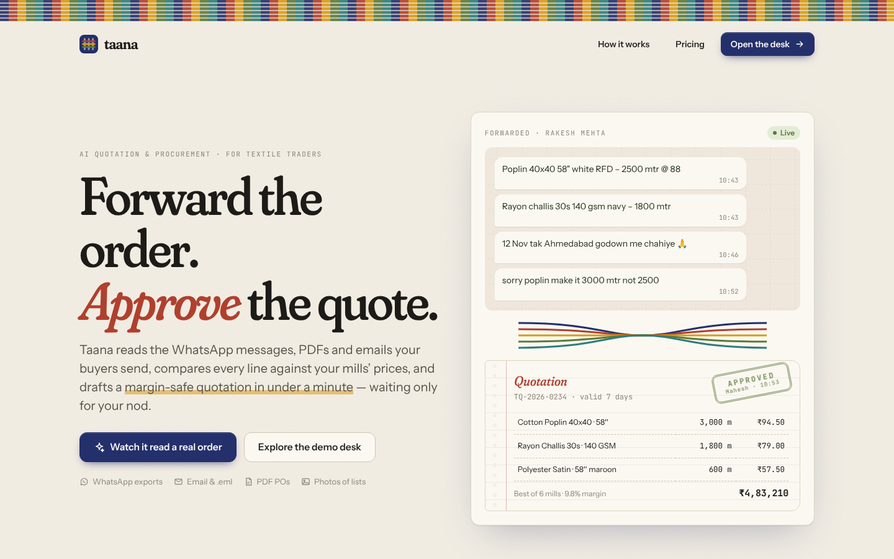
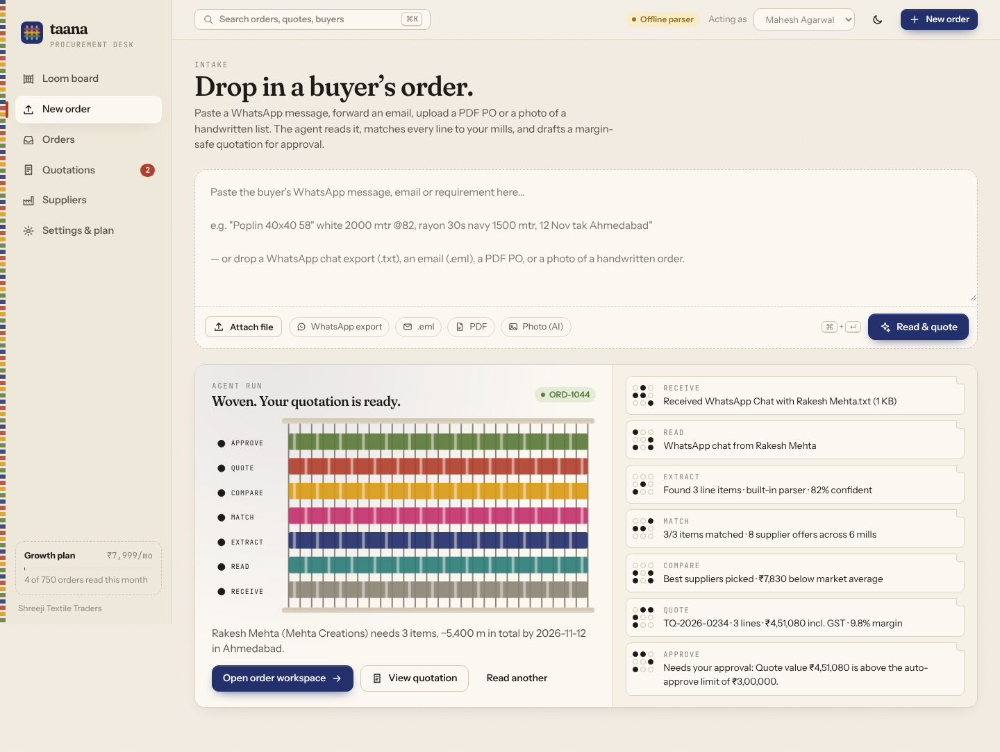
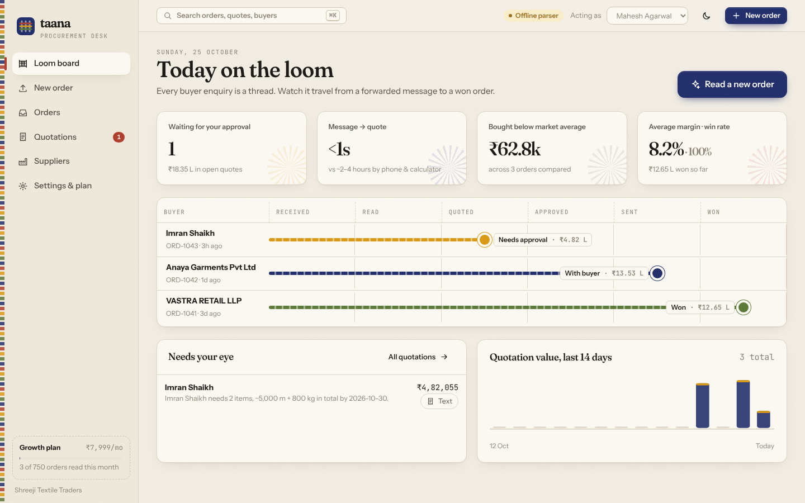
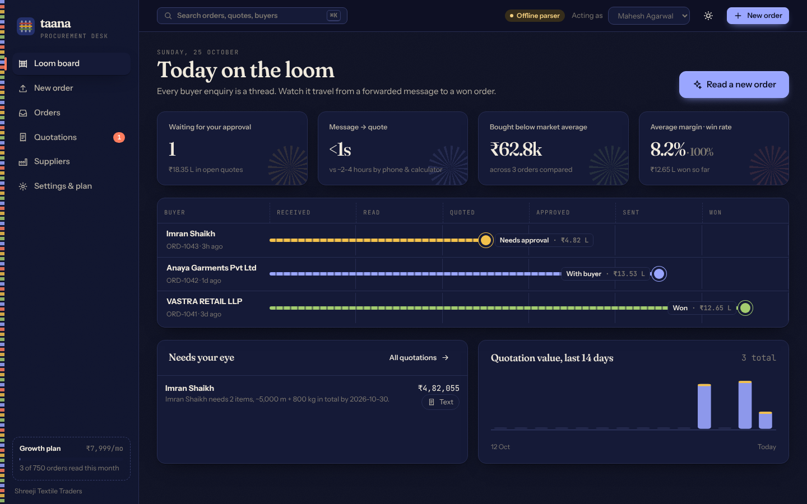
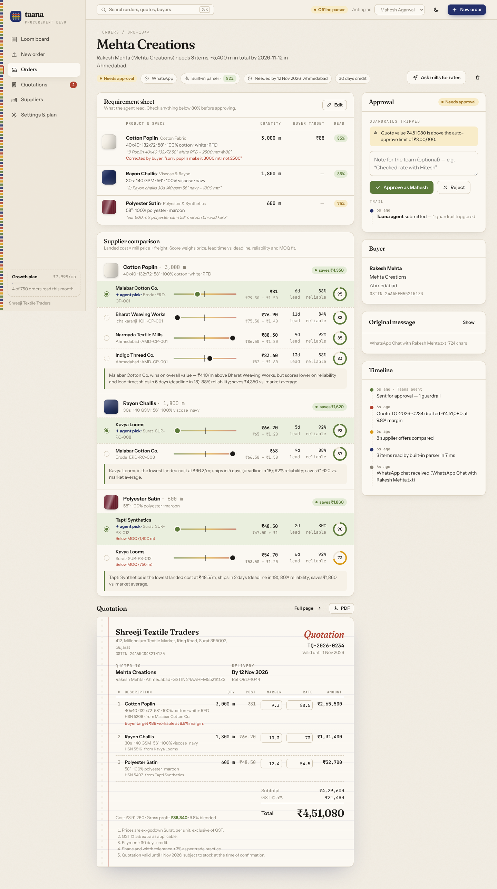
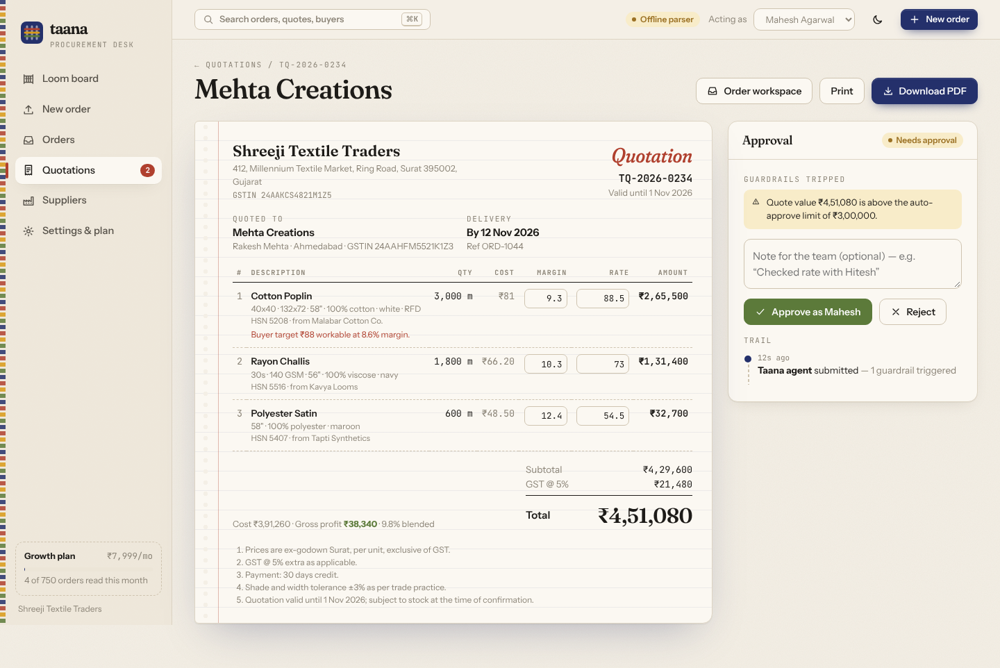
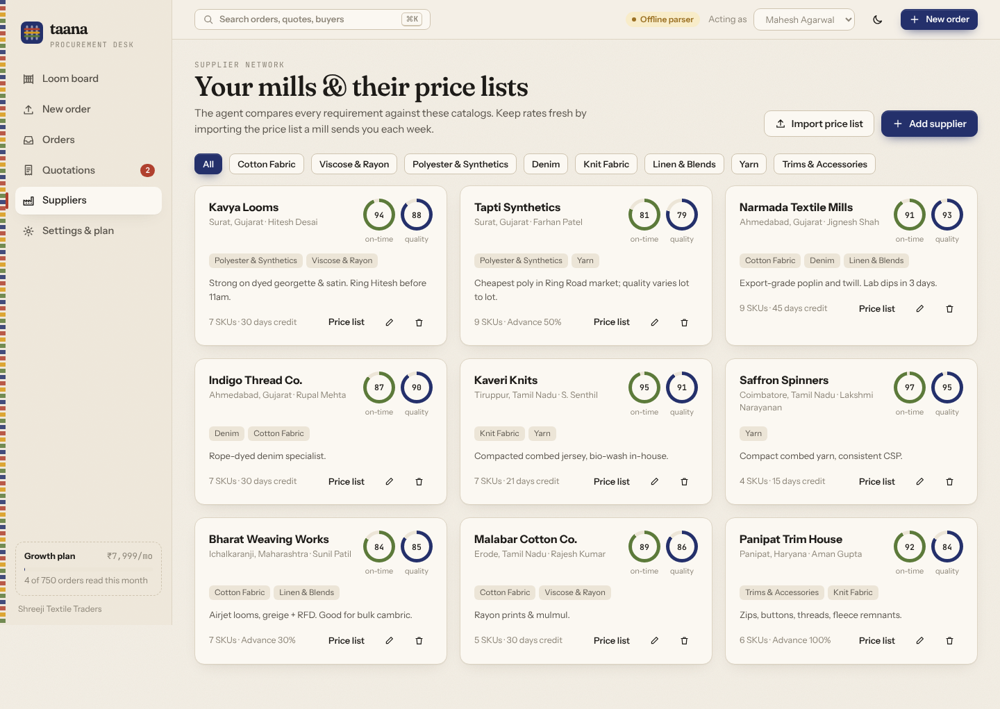
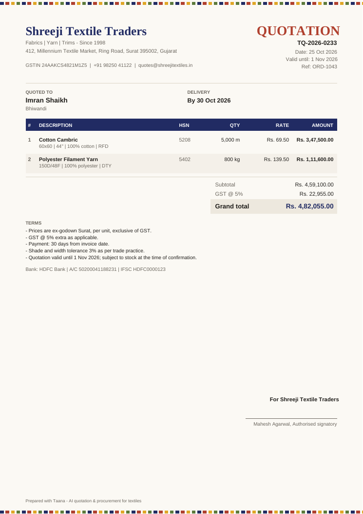

# Taana — AI Quotation & Procurement Agent for textiles

> **Forward the order. Approve the quote.**
> Taana reads the WhatsApp messages, PDFs and emails buyers send, compares every line against your mills' prices, and drafts a margin-safe quotation for approval in under a minute.

*Taana* (ताना) is the warp: the threads on a loom that every other thread runs through. Every order in a textile business runs through the procurement desk, and that desk is what Taana automates.



---

## The problem

India's textile trade runs on WhatsApp. A trader in Surat's Ring Road market or a garment unit in Tiruppur gets dozens of messages a day like:

> *"Poplin 40x40 58" white RFD 2500 mtr @88… 12 Nov tak Ahmedabad godown me chahiye… sorry poplin make it 3000 not 2500"*

Turning one of those into a rate takes **2–4 hours**. Someone reads the chat, calls 3–5 mills for today's price, works out freight, adds a margin on a calculator, then types a reply. Quotes priced from memory lose **1–3% of margin**: freight gets forgotten, an old rate gets used, an MOQ gets missed. The shop that answers first usually gets the order.

## The product

| | |
|---|---|
| **Customers** | Textile traders, garment manufacturers, wholesalers |
| **Input** | WhatsApp chat exports, pasted messages, emails (`.eml` with attachments), PDF purchase orders, photos/screenshots of handwritten lists |
| **Output** | A structured requirement sheet, a scored supplier comparison, and a branded GST quotation sent through an approval workflow |
| **Revenue** | Monthly subscription per business: Starter ₹2,999 · Growth ₹7,999 · Mill ₹19,999 (metered by orders read) |

### How the agent works

```
 receive ─▶ read ─▶ extract ─▶ match ─▶ compare ─▶ quote ─▶ approve
   │         │        │          │         │          │         │
 file/text  detect   Claude     spec      landed     margin    guardrails:
            format   structured similarity cost +    rules +   value, margin,
            (chat,   output →   vs. every  score:    rounding  confidence,
            email,   requirement mill SKU  price,    + GST     deadline →
            PDF,     sheet                 lead vs.            auto-approve
            image)                         deadline,           or wait for
                                           reliability,        a human
                                           MOQ/stock
```

The UI shows every run live as a **loom**: each finished stage weaves a dyed weft band, and each step is "punched" onto a Jacquard-style card.



1. **Read anything.** WhatsApp exports (Android and iOS formats), emails with PDF/image attachments, PDF POs and photos. Claude reads PDFs and images natively.
2. **Extract like a procurement clerk.** Claude returns a schema-validated requirement sheet: product, category, count vs. construction (`40x40` vs. `132x72`), GSM (including oz→GSM for denim), width, colour, finish, quantity and unit (dozens, gross, *thaan*, *2k*, lakh), the buyer's target price, deadline, delivery location and payment terms. It applies corrections ("make it 3000 not 2500"), handles Hinglish, and writes **only the clarifying questions that change the price**.
3. **Match and compare.** Every line is matched against every mill's catalog by spec similarity. Each offer is costed **to the door** (mill price + freight per unit) and scored on price, lead time *against the buyer's deadline*, the mill's on-time and quality record, and MOQ/stock fit. Every pick comes with a plain-English reason.
4. **Price the quote.** Category margins with a hard floor, rounding to your price step, and GST. It also checks the buyer's target price ("₹88 is workable at 8.6% margin" / "below cost + minimum margin").
5. **Approve.** Quotes inside every guardrail are auto-approved. Anything else (value above the limit, a margin under the floor, low reading confidence, a mill that would miss the deadline, a missing price) waits for an approver, who sees exactly which guardrail tripped, can adjust margins inline, and stamps it.
6. **Send.** One tap opens WhatsApp or email with a ready-written message, plus a branded PDF. Then mark it won or lost.
7. **No price on file?** It drafts RFQ messages to every mill that deals in the category.

## Screens

| Loom board (dashboard) | Night-shift theme |
|---|---|
|  |  |

| Order workspace | Quotation & approval |
|---|---|
|  |  |

| Supplier network | PDF quotation |
|---|---|
|  |  |

**Design language: the "handloom ledger".** Khadi-paper backgrounds, indigo ink, and natural-dye accents (madder, turmeric, mehendi, kasturi). Pipelines are drawn as threads, products as woven fabric swatches (plain, twill, satin, knit, yarn), comparisons as selvedge bars, quotations as a perforated bill book with a carbon-copy tint and a rubber-stamp approval. The dark theme is "night shift at the mill". It also has ⌘K search, an "acting as" approver switcher, keyboard submit, full mobile layouts and reduced-motion support.

---

## Quick start

```bash
npm install
cp .env.example .env.local    # optional: add ANTHROPIC_API_KEY
npm run dev                   # http://localhost:3000
```

The first request seeds a demo workspace: a Surat trading house with 9 mills, ~60 SKUs and three orders at different stages. Open **New order** and pick a sample, or drop in the files in [`samples/`](samples).

### With or without AI

| | With `ANTHROPIC_API_KEY` | Without |
|---|---|---|
| Reading engine | **Claude** (`claude-opus-5-5`, structured outputs) | Built-in rule-based textile parser |
| WhatsApp / email / text | ✅ including messy, multi-message, Hinglish | ✅ common trade formats |
| PDF with a text layer | ✅ read natively | ✅ |
| Scanned PDFs & photos | ✅ vision | ⚠️ asks you to add a key |

If the AI call fails (network, rate limit, refusal), Taana falls back to the built-in parser and flags the order for review. A quote is never silently lost.

| Env var | Default | Purpose |
|---|---|---|
| `ANTHROPIC_API_KEY` | — | Enables Claude extraction |
| `TAANA_MODEL` | `claude-opus-5-5` | Model used for extraction |
| `TAANA_EFFORT` | `medium` | `low` … `max`: reading depth vs. cost |
| `TAANA_DATA_DIR` | `./.data` | Where the JSON datastore lives |

## Scripts

| Command | |
|---|---|
| `npm run dev` / `build` / `start` | Next.js |
| `npm test` | Unit tests: parsers, matching, scoring, pricing, guardrails, and the Claude request contract |
| `npm run lint` | TypeScript type-check |
| `npm run seed` | Reset the workspace to demo data |
| `npx tsx scripts/make-samples.ts` | Regenerate `samples/` |

---

## Architecture

```
src/
├─ app/
│  ├─ page.tsx                  landing page
│  ├─ desk/                     the app: loom board, intake, orders, quotes, suppliers, settings
│  └─ api/                      route handlers (below)
├─ components/                  Loom, QuoteSheet, Comparison, RequirementSheet, Shell, ui
└─ lib/
   ├─ agent/
   │  ├─ prompt.ts              extraction system prompt (byte-stable → prompt-cached)
   │  ├─ schema.ts              Zod schema → Claude structured output
   │  ├─ extract.ts             Claude call + fallback
   │  ├─ heuristic.ts           offline textile parser
   │  ├─ compare.ts             spec matching, landed cost, scoring
   │  ├─ quote.ts               pricing, GST, guardrails, WhatsApp/email drafts
   │  └─ pipeline.ts            the staged agent run (streams events)
   ├─ ingest/                   WhatsApp, email (.eml), PDF, image normalisation
   ├─ db.ts                     atomic, serialised JSON datastore
   ├─ seed.ts · samples.ts      demo workspace
   ├─ pdf.ts                    branded A4 quotation (pdf-lib)
   └─ services.ts               order/quote/supplier/settings use-cases
```

### Claude integration

* **Structured outputs:** `client.beta.messages.parse` with `betaZodOutputFormat(Extraction)`, so the response is validated against the Zod schema before it reaches the pricing engine.
* **Native documents:** PDFs go to Claude as `document` blocks and photos as `image` blocks. A PDF's text layer isn't sent twice.
* **Prompt caching:** the system prompt (trade vocabulary, canonical catalog names, extraction rules) contains no per-request data and carries `cache_control`. Today's date and the document go in the user turn.
* **Refusal handling:** `fallbacks: "default"` (beta `server-side-fallback-2026-07-01`) plus explicit `stop_reason` checks. Typed SDK errors map to readable warnings.
* **Effort:** configurable via `TAANA_EFFORT`. The default is `medium`.

### API

| Method | Path | |
|---|---|---|
| `POST` | `/api/ingest` | multipart `file` / `text` / `sample` → **NDJSON stream** of agent events |
| `GET` | `/api/orders` · `/api/orders/:id` | list / detail (order + quote) |
| `PATCH` · `DELETE` | `/api/orders/:id` | edit requirement lines (re-compares & re-prices) / delete |
| `POST` | `/api/orders/:id/select` | switch the supplier for a line |
| `GET` | `/api/orders/:id/rfq` | RFQ drafts per item and supplier |
| `GET` · `PATCH` | `/api/quotes/:id` | detail / change a line's margin or rate |
| `POST` | `/api/quotes/:id/action` | `approve` · `reject` · `send` · `won` · `lost` · `reopen` (state machine enforced) |
| `GET` | `/api/quotes/:id/pdf` | branded PDF |
| `GET` · `POST` | `/api/suppliers` | list / add |
| `PATCH` · `DELETE` | `/api/suppliers/:id` | edit / remove |
| `POST` | `/api/suppliers/import` | CSV price list (creates mills, upserts SKUs) |
| `GET` · `PATCH` | `/api/settings` | margins, guardrails, weights, plan |
| `GET` | `/api/stats` · `/api/health` | KPIs · AI status |
| `POST` | `/api/demo/reset` | restore demo data |

### Data

A single JSON document (`.data/db.json`) written atomically through a serialised mutation queue. `lib/db.ts` exposes only `read()` and `mutate()`, so switching to Postgres is a one-module change. On Vercel it writes to `/tmp`, which is fine for demos. Use a real database in production.

## Roadmap

- WhatsApp Business API inbox (receive orders directly, no export needed)
- Multi-tenant auth & per-seat roles (sales / approver / owner); Razorpay subscription billing
- Mill portal: suppliers update their own rate lists; automatic RFQ round-trips
- Buyer-specific margin matrices and credit limits; Tally / Busy export of won orders
- Rate-history analytics: which mill is drifting up, which buyer always negotiates

---

Built with Next.js 15, React 19, TypeScript, the Anthropic SDK, pdf-lib, unpdf and postal-mime. No UI kit: the design system is hand-written CSS.
